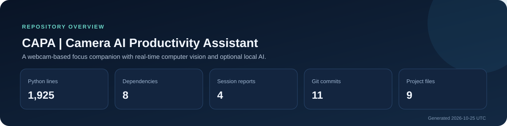

# CAPA | Camera AI Productivity Assistant

> A webcam-based focus companion with real-time computer vision and optional local AI.



CAPA (Control-System Camera AI-Powered Productivity Assistant) is a Python desktop application that uses a webcam to estimate desk presence, movement, and visual attention during work sessions. It pairs live feedback with session transcripts and detailed reports, and can optionally request coaching summaries from a local OpenAI-compatible language model.

**Project repository:** [2320633/Control-System-Camera-AI-Powered-Productivity-Assistant-CAPPA-](https://github.com/2320633/Control-System-Camera-AI-Powered-Productivity-Assistant-CAPPA-)

## Highlights

- **Live focus sessions** — Capture webcam frames and combine motion with detected presence to classify focused, distracted, and absent states.
- **Face, eye, and posture signals** — Use OpenCV face and eye cascades, body detection, and head-position signals to inform session feedback.
- **Motion-based inactivity alerts** — Track motion over time and surface prompts when activity remains low.
- **Optional local AI coaching** — Request productivity prompts and session summaries from a locally hosted, OpenAI-compatible language model.
- **Session transcripts and reports** — Show live session feedback and save a detailed text report with focus, motion, expression, and recommendation summaries.

## Project snapshot

| Metric | Value |
| --- | ---: |
| Python source lines | 1,925 |
| Declared dependencies | 8 |
| Session report examples | 4 |
| Project files | 9 |
| Git commits | 15 |
| Languages and formats | Markdown (2), Python (2), JSON (1), Jupyter notebooks (1), Python dependencies (1), YAML (1) |

The inventory excludes generated session report contents and local runtime state. Report examples are counted by filename only; their personal session data is not reproduced here.

## Progress and achievements

- **5 code-backed capabilities detected:** Live focus sessions, Face, eye, and posture signals, Motion-based inactivity alerts, Optional local AI coaching, Session transcripts and reports.
- **4 session report examples present**; this dashboard counts filenames only.
- **Latest recorded change:** 2026-10-28 — docs(dashboard): refresh repository showcase.

## Project structure

- [`.github/workflows/dashboard.yml`](./.github/workflows/dashboard.yml)
- [`CAPA.ipynb`](./CAPA.ipynb)
- [`CAPA.py`](./CAPA.py)
- [`dashboard/assets/repository-summary.svg`](./dashboard/assets/repository-summary.svg)
- [`dashboard/config.json`](./dashboard/config.json)
- [`dashboard/dashboard.py`](./dashboard/dashboard.py)
- [`dashboard/README_TEMPLATE.md`](./dashboard/README_TEMPLATE.md)
- [`README.md`](./README.md)
- [`requirements.txt`](./requirements.txt)

## Getting started

### Requirements

- Python 3.8 or later
- A webcam supported by OpenCV

### Install

```bash
git clone https://github.com/2320633/Control-System-Camera-AI-Powered-Productivity-Assistant-CAPPA-.git
cd Control-System-Camera-AI-Powered-Productivity-Assistant-CAPPA-
python -m venv .venv
```

Activate the virtual environment, then install the project dependencies:

```bash
# Windows PowerShell
.venv\Scripts\Activate.ps1

# macOS / Linux
source .venv/bin/activate

python -m pip install -r requirements.txt
```

### Run a session

Start the desktop monitor with:

```bash
python CAPA.py
```

Allow camera access when prompted. The OpenCV window supports **S** to begin, **C** to switch cameras, and **Q** to quit. The interactive walkthrough is also available in [CAPA.ipynb](./CAPA.ipynb).

### Optional local AI

For AI-generated prompts and summaries, start an OpenAI-compatible local model server at `http://127.0.0.1:1234` before running CAPA. The current implementation requests `nvidia/nemotron-3-nano-4b`; the local server must have a compatible model loaded. Camera monitoring and basic session analysis are separate from this optional service.

## Roadmap

The items below are generated from the current repository contents. A milestone disappears automatically when its corresponding tests, evaluation assets, calibration guidance, or test workflow are added.

- **Add automated regression tests** — Cover motion thresholds, presence and attention classification, and report generation so changes can be checked without camera hardware.
- **Validate focus signals against labeled sessions** — Measure classification behavior across varied lighting, camera positions, and user-confirmed focus labels; document known limitations.
- **Add camera setup and calibration guidance** — Help users choose a camera position and tune detection thresholds for their lighting and workspace.
- **Run project checks automatically** — Add a test-focused CI job that runs the regression suite and lightweight source checks on proposed changes.

## Recent development

- **Latest commit:** docs(dashboard): refresh repository showcase
- **Latest commit date:** 2026-10-28
- **Recent commits:**

- `2026-10-28` — docs(dashboard): refresh repository showcase
- `2026-10-27` — docs(dashboard): refresh repository showcase
- `2026-10-26` — docs(dashboard): refresh repository showcase
- `2026-10-25` — docs(dashboard): refresh repository showcase
- `2026-10-24` — docs(dashboard): refresh repository showcase

## Privacy and interpretation

CAPA reads webcam frames for on-device OpenCV analysis. The application writes text session reports to its working directory; inspect and manage those files as personal data. When enabled, AI prompts and session summaries are sent to the configured local model server. Focus and attention labels are heuristic signals, not objective measurements, and can be affected by lighting, camera placement, and individual differences.

## Dashboard maintenance

This README and its summary graphic are regenerated daily by [`.github/workflows/dashboard.yml`](./.github/workflows/dashboard.yml). The generator uses Python's standard library, reads repository metadata and source files, and updates these generated files only when their content changes.

**Dashboard last generated:** 2026-10-29 (UTC)
